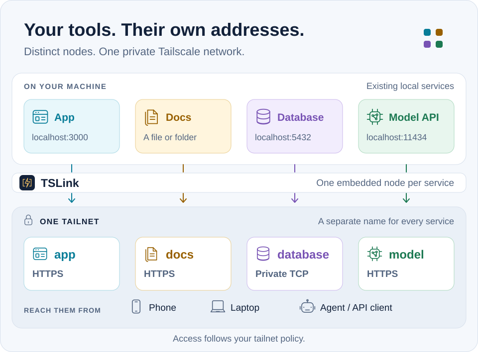

<p align="center">
  <picture>
    <source media="(prefers-color-scheme: dark)" srcset="assets/tslink-mark-dark.svg">
    
  </picture>
</p>
<h1 align="center">TSLink</h1>
<p align="center">TSLink — это CLI и MCP-сервер с открытым исходным кодом: он даёт каждому приложению на вашем компьютере приватный адрес <code>https://&lt;name&gt;.&lt;tailnet&gt;.ts.net</code>, чтобы вы или ваш coding agent могли открыть работающий dev-сервер на телефоне. Независимый проект, не разработан Tailscale.</p>
<p align="center">На телефоне нужно приложение Tailscale с входом в тот же tailnet.</p>
<p align="center"><strong>Русский</strong> · <a href="../README.md">English</a> · <a href="README.zh-CN.md">简体中文</a> · <a href="README.ja.md">日本語</a> · <a href="README.ko.md">한국어</a> · <a href="README.es.md">Español</a> · <a href="INDEX.md#translated-homepages">Другие языки</a></p>

```text
# Claude Code, после установки CLI (см. раздел «Установка» ниже)
/plugin marketplace add anydoor7/tslink
/plugin install tslink@tslink

# Локальные MCP-клиенты, использующие JSON с mcpServers (другие: см. настройку MCP в вашем клиенте)
{"mcpServers":{"tslink":{"command":"tslink","args":["mcp"]}}}

Скажите агенту: «Поделись dev-сервером, чтобы я мог открыть его на телефоне».
```

То же самое вручную, когда dev-сервер уже слушает порт 5173. С флагом `--json` команда `share` сообщает зарегистрированное имя в `data.name`. Используйте это имя в следующих командах: оно отличается от `--name`, если такое имя было занято, например `web-2`.

```sh
tslink share 5173 --name web --json   # data.name; data.url, или data.auth_url (ссылка для входа в Tailscale), если status равен needs_login
tslink url <name> --wait              # после входа: точный URL
tslink remove <name>                  # когда закончите; пропустите, если share не удался. Dev-сервер продолжает работать
```

<a id="installation"></a>
<a id="quickstart"></a>

## Установка

Для компьютеров macOS требуется macOS 13 Ventura или новее ([поддерживаемые платформы](platforms.md)).

```sh
brew install --cask anydoor7/tap/tslink
```

В Windows установите через Scoop:

```powershell
scoop bucket add anydoor7 https://github.com/anydoor7/scoop-bucket
scoop install anydoor7/tslink
```

Для обновления выполните `brew upgrade --cask tslink` или `scoop update; scoop update tslink`. Если TSLink работает как фоновая служба, после обновления снова выполните `tslink install`.

Пакеты `.deb` и `.rpm` для Linux и сборки для Windows есть в [последнем релизе](https://github.com/anydoor7/tslink/releases/latest). Когда вы впервые делитесь приложением, TSLink выводит для него ссылку для входа в Tailscale. [Начало работы](getting-started.md)

<a id="agents"></a>

## Для ИИ-агентов

Dev-сервер, который агент запустил на `localhost`, недоступен с вашего телефона. TSLink позволяет агенту дать ему приватный адрес, передать вам точный URL и убрать общий доступ после работы. На телефоне нужно приложение Tailscale с входом в тот же tailnet.

Проверено 2026-10-22 с Vite 8.3.5 и iPhone 15 Pro: агент открыл общий доступ к dev-серверу через MCP, телефон открыл приватный URL, а страница обновилась при сохранении без ручной перезагрузки.

Для Claude Code сначала установите CLI, затем выполните:

```text
/plugin marketplace add anydoor7/tslink
/plugin install tslink@tslink
```

В плагин входят [skill для предпросмотра](../skills/tslink-preview/SKILL.md) и MCP-подключение ниже. Маркетплейс остаётся в этом репозитории и забирает плагин из [anydoor7/tslink-claude-plugin](https://github.com/anydoor7/tslink-claude-plugin). Основной skill хранится здесь; в плагине лежит копия, которую проверяет CI. Другие агенты могут использовать тот же skill или подключать MCP напрямую. Для этой интеграции нужен локальный CLI, в чате claude.ai она не работает. [Настройка и регистрация](agent-integrations.md)

Для локального MCP-клиента, который использует JSON с `mcpServers` (другие клиенты: см. их инструкции по настройке MCP и [руководство по MCP-клиентам](mcp-clients.md)):

```json
{"mcpServers":{"tslink":{"command":"tslink","args":["mcp"]}}}
```

- **Одно имя на каждый dev-сервер.** При каждом предоставлении доступа приложению назначается свой приватный адрес `https://<name>.<tailnet>.ts.net` в корневом пути на порту 443. Если имя занято, к нему добавляется числовой суффикс, поэтому используйте URL, который вернулся агенту.
- **Для каждого нового приложения нужен человек.** В настройках по умолчанию для каждого нового узла приложения человек должен завершить регистрацию в Tailscale. Если результат — `needs_login`, завершите вход, затем выполните `tslink url <name> --wait`, чтобы получить точный URL. Отдельно: новое имя может стать доступным не сразу — от 36 до 38 секунд в двух наших тестовых запусках.
- **Кто может открыть.** По умолчанию — устройства tailnet, которые разрешает ваша политика. `share` в MCP принимает `allow`, чтобы ограничить доступ вашим логином; в CLI используйте `tslink add web --proxy localhost:5173 --allow you@example.com`. Имена видны в публичных журналах сертификатов, поэтому не являются секретом.
- **Правите, сохраняете, видите.** Сохранение кода обновляет страницу на телефоне. Собственные правила Host и Origin вашего приложения всё равно могут блокировать запросы: в нашем тесте Vite не потребовал менять `allowedHosts`; Next.js не проверялся и по-прежнему требует `allowedDevOrigins`.
- **Очистка.** Агент вызывает `unshare`, или вы запускаете `tslink remove <name>`, всегда с именем, которое вернул результат share. Команда удаляет запись о предоставленном доступе и пытается удалить соответствующий узел tailnet, когда TSLink может доказать, что узел принадлежит ему, поэтому проверьте в результате поля об очистке или сохранённом состоянии. Dev-сервер она не останавливает.
- **CLI или MCP.** Команды управления принимают `--json` и возвращают версионированные результаты; `tslink mcp` даёт операции с приложениями и доступом через MCP.
- **Один файл, а не папка.** Агент может поделиться только своим самодостаточным HTML-отчётом командой `tslink share ./report.html`; остальные файлы в этой папке остаются недоступными.
- **Ограниченные роли.** `viewer`, `app-operator` или `people-manager`, в пределах указанных вами приложений; чтобы поделиться новым приложением, нужна роль `owner`. `tslink mcp-audit` показывает, что изменил агент. Роли ограничивают инструменты TSLink, а не собственную оболочку агента.

[Руководство агента](agent-quickstart.md) · [Права MCP](mcp-scopes.md) · [Удалённый MCP](remote-mcp.md)

<a id="why"></a>

## Когда нужен TSLink

Для одного приложения, которое вы запускаете сами и открываете на своём телефоне, хватит Serve. TSLink нужен для dev-серверов, которые запускает агент, часто нескольких, когда у каждого должно быть своё приватное имя, а общий доступ, URL и очистка должны быть готовыми шагами в CLI, MCP и skill для Claude Code.

| Задача | Только Tailscale | TSLink |
|---|---|---|
| Несколько dev-серверов, запущенных агентом, по имени на каждый | Serve задаёт маршруты на уровне устройства под одним именем на машину; Services требует для каждого имени определение, одобрение и хост с тегами | Один узел на приложение; общий доступ, получение URL и очистка уже встроены в CLI (`share`, `url`, `remove`), MCP (`share`, `url`, `unshare`) и skill |
| Одно приложение, которое вы запускаете сами, на телефоне | Хватит `tailscale serve 3000` | `tslink share 3000` |
| Один человек, одно приложение, семь дней | Правила политики, затем JIT-инструмент или удаление вручную | `tslink people add alice@example.com --apps photos --for 7d` (HTTP/файлы) |
| Ссылка для браузера, три дня | Публичный Funnel; защиту доступа и отключение по расписанию добавить самому | `tslink guest create photos --for 3d --public --print-link` (только HTTP) |

Приватным получателям нужен Tailscale. Гостевые ссылки публичны, их можно пересылать; они служат ключами доступа.

[Полное сравнение](comparison.md#tailscale-alone-or-tslink)

<a id="use-cases"></a>

## Ваши приложения на ваших устройствах

- **Свой адрес у каждого приложения.** Веб-приложения, папки, отдельные файлы и TCP-порты получают собственные имена в вашем tailnet, поэтому вы пользуетесь именами вместо IP-адресов.
- **Приватно по умолчанию.** Ничего не становится публичным, пока вы не создадите гостевую ссылку или не опубликуете через Funnel.
- **Одно приложение, а не вся машина.** Каждое публикуемое приложение получает собственный узел, который пересылает трафик только этому приложению. Без приложения Tailscale на хосте TSLink не добавляет в ваш tailnet другие порты хоста.
- **Домашняя страница** со списком ваших приложений и их состоянием. [Портал](portal.md)
- **Проверки состояния и оповещения** через команду или webhook, а также журнал доступа, где видны и отклонённые запросы. [Состояние и оповещения](health-and-alerts.md) · [История доступа](access-log.md)
- **Рецепты для 15 self-hosted приложений**, включая Home Assistant, Jellyfin, Immich и Ollama. `tslink apps detect` находит уже запущенные. [Рецепты приложений](apps.md)

## Делитесь, когда захотите

```sh
tslink people add alice@example.com --apps notes --for 7d   # a tailnet member, for 7 days
tslink guest create notes --for 3d --public --print-link    # a browser link, no Tailscale needed
tslink add launch --proxy localhost:4000 --funnel --public --funnel-ttl 1h   # anyone, for one hour
```

Гостевые ссылки и новые публичные URL истекают и работают только для веб-приложений; папки, файлы и TCP-порты остаются приватными. [Доступ для людей](people.md) · [Гостевые ссылки](guest-links.md) · [Публичный доступ](funnel.md)

<a id="architecture"></a>

## Как это работает

<picture>
  <source media="(max-width: 600px) and (prefers-color-scheme: dark)" srcset="assets/service-map-dark-mobile.svg">
  <source media="(max-width: 600px)" srcset="assets/service-map-light-mobile.svg">
  <source media="(prefers-color-scheme: dark)" srcset="assets/service-map-dark.svg">
  
</picture>

Один фоновый процесс запускает отдельный узел Tailscale для каждого приложения. Tailscale обеспечивает транспорт в tailnet и HTTPS-сертификаты. Приватный доступ к веб-приложениям и файлам можно ограничить по учётной записи Tailscale с помощью `--allow` и доступа для людей; чистый TCP полагается на политику вашего tailnet и собственный вход приложения. [Архитектура](architecture.md)

<a id="requirements"></a>

## Требования

| Кто | Что нужно |
|---|---|
| Вы | Аккаунт Tailscale с включёнными MagicDNS и HTTPS |
| Машина, где работают ваши приложения | TSLink, в который встроен Tailscale (в Linux также пользовательская сессия systemd) |
| Ваши устройства и те, с кем вы делитесь | Приложение Tailscale |
| Гости | Браузер |

Имена HTTPS-приложений попадают в публичные журналы сертификатов, поэтому выбирайте имена, которые можно показать другим.

<a id="documentation"></a>

## Ещё

[Вся документация](INDEX.md) · [Справочник CLI](cli-reference.md) · [Сравнение с Serve, ngrok и Cloudflare](comparison.md) · [Участие в проекте](../CONTRIBUTING.md) · [Безопасность](../SECURITY.md)

Apache 2.0. TSLink — независимый проект, его не создавала и не одобряла Tailscale.
